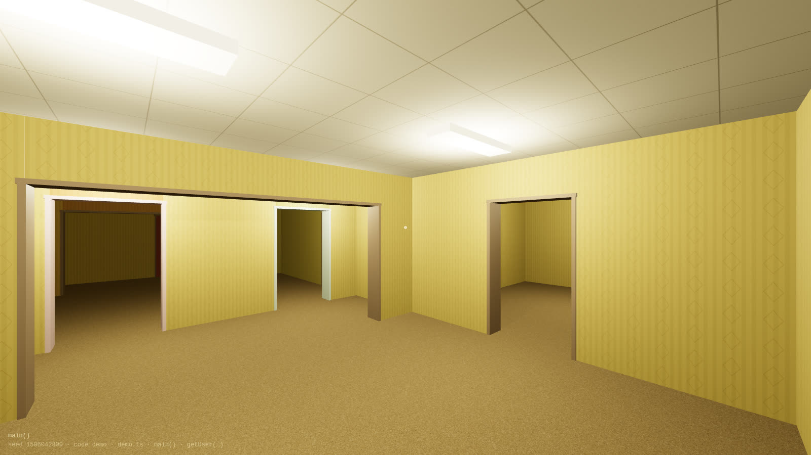
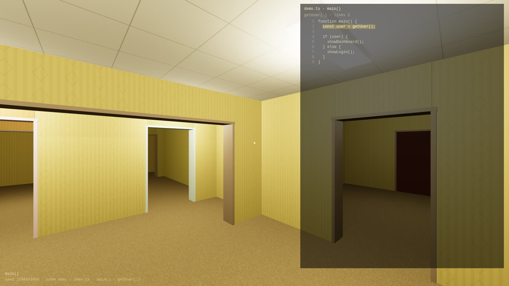
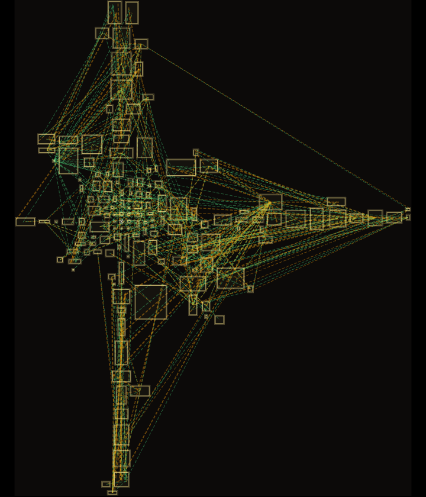
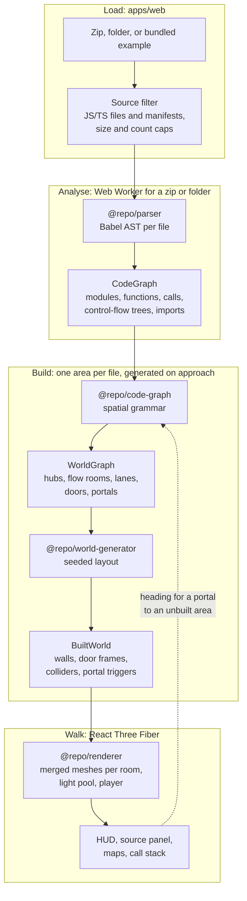

# Code Backrooms

**Walk through a codebase as a Backrooms level.** Files are areas, functions
are rooms, an `if` forks into two lanes, a loop is a ring you can walk around,
and every call is a door.

**[▶ Try it in the browser](https://code-backrooms.valuecodes.fi/)** ·
[Walk this repository](https://code-backrooms.valuecodes.fi/?code=self)



Drop a zip of any JavaScript or TypeScript repository on the page, or pick a
folder. Nothing is uploaded: the code is parsed in your browser tab.

## What you are walking through

| Code                 | Space                                                   |
| -------------------- | ------------------------------------------------------- |
| Repository           | The world, starting in an entrance hall                 |
| Workspace package    | A zone                                                  |
| File                 | An area: a hub room with doors to its functions         |
| Function             | A column of rooms, one per run of statements            |
| `if` / `else`        | A fork room, a green lane and a red lane, a merge room  |
| `switch`             | One lane per case, in source order                      |
| Loop                 | A ring: body, a "repeat" door back to the head, an exit |
| Call                 | A door to the callee, or a portal if it already has one |
| `return`             | A portal back to where you came from                    |
| `break` / `continue` | A jump portal to the loop's end or head                 |

The layout is built from the code, so the same code always gives the same
world. The world shows what _can_ run, not a trace of what did run.

<table>
  <tr>
    <td width="50%"></td>
    <td width="50%"></td>
  </tr>
  <tr>
    <td>Press E: every room shows the code it came from.</td>
    <td>Press Tab: this repository as a world of 152 areas.</td>
  </tr>
</table>

## Controls

| Key           | Action                                  |
| ------------- | --------------------------------------- |
| WASD / arrows | Move, Shift to sprint                   |
| Mouse         | Look (click the scene to lock it)       |
| E             | Show the current room's source code     |
| Tab           | Map of the whole world                  |
| M             | Map of the rooms you have walked        |
| Backspace     | Back to where this function was entered |
| R             | Back to the entrance                    |
| Esc           | Release the mouse                       |

## Run it locally

Needs Node.js 24 and pnpm 12.

```bash
pnpm install
pnpm dev
```

Then open http://localhost:3000.

## How it works

Everything runs in the browser tab. Code decides which rooms and doors exist.
A seed taken from a hash of the source decides only sizes and placement, so
the same code always gives the same world.



| Package                    | Job                                                         |
| -------------------------- | ----------------------------------------------------------- |
| `packages/parser`          | Babel parses JS and TS into functions, calls and flow trees |
| `packages/code-graph`      | Turns code into rooms, doors and portals                    |
| `packages/world-generator` | Places rooms from a seed and builds walls and colliders     |
| `packages/renderer`        | Draws the world with React Three Fiber                      |
| `apps/web`                 | Loading, HUD, source panel and maps                         |

Each file is generated as its own area when you first head for it, so large
repositories open quickly. Contributor notes live in [AGENTS.md](AGENTS.md).

## Commands

```bash
pnpm lint           # type-aware linting, whole repo in one oxlint process
pnpm knip           # unused files, exports and dependencies
pnpm typecheck      # TypeScript 7 (tsc) across the repo
pnpm test           # test suite
pnpm build          # production builds
pnpm format         # Prettier write
pnpm format:check   # Prettier check (CI gate)
pnpm secrets:scan   # gitleaks secret scan over git history
```

oxlint prints nothing when there are no findings, so silent output means clean.

CI runs typecheck, lint, knip, format-check, test, build and a gitleaks secret scan on
push to `main` and on PRs, plus CodeQL code scanning. `secrets:scan` needs either
`gitleaks` v8.19+ on PATH or a running Docker daemon.

## Limits

- JavaScript and TypeScript only.
- Up to 400 source files and 8 MB per repository.
- Calls through objects (`obj.method()`) and callbacks show as closed doors.
- GitHub URLs load public repositories only, and branch names containing `/` are not
  supported.

## License

[MIT](LICENSE)
